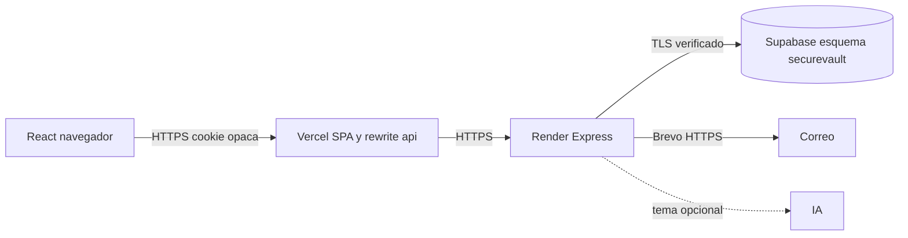

# Arquitectura

Vite hace proxy /api en desarrollo. Producción usa mismo origen efectivo con rewrite externo. El navegador no llama Render/Supabase directamente. Sin CORS abierto; Origin y CSRF además de SameSite=Lax.

Cookie opaca de 32 bytes aleatorios, solo hash SHA-256 en BD. HttpOnly, host-only, path=/ y Secure en producción con nombre __Host-sv. Sesión anónima para CSRF. Login destruye sesión previa y crea ID y token nuevos. Inactividad 30 minutos, absoluta 8 horas. Cada petición consulta User/authVersion: cambios de rol, desactivación y recuperación invalidan sesiones.

app.js compone HTTP y registra rutas explícitas; server.js abre puerto y gestiona cierre. services implementa reglas/transacciones/cifrado; controllers/profile adapta el perfil. No se crean carpetas vacías para simular capas. DTO explícito para cuentas/eventos. Sequelize parametriza; SQL fijo para migraciones/advisory locks.

## Permisos

- Anónimo: salud, CSRF, registro, login, recuperación; mutaciones con CSRF.
- Usuario: diario/perfil propios y ayuda. No puede enviar ownerId o role.
- Administrador: sus datos propios y gestión de cuentas/eventos. Entradas/teléfonos ajenos denegados; 404 uniforme para IDOR.
- Resto denegado. No hay edición/borrado de auditoría vía API.

Bloqueo de fila de usuario serializa límite de 100 entradas. Recuperación bloquea usuario y token. Administración usa advisory lock y vuelve a verificar al actor dentro de transacción. Auditoría comparte transacción con cambio y revocación.

Límites: correo sin cola de reintentos; entrega fallida se audita y responde genérico. Sin versionado de ediciones ni recuperación de llaves. Rate limit general por proceso. Topología de proxy requiere prueba pública real.
