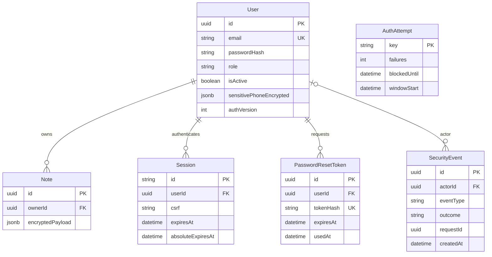

# Modelo de datos

001-initial.sql define restricciones, claves e índices de propietario, expiración, usuario y evento. Correo único normalizado y rol con CHECK. UUID generado por aplicación. Columnas camelCase se entrecomillan en PostgreSQL; no usar backticks de MySQL. JSONB contiene el sobre criptográfico.

Note cifra título, cuerpo, fecha elegida, ánimo, etiquetas, favorito, color y portada. Validar antes/después del cifrado. Sin LIKE sobre ciphertext. Máximo 100 registros del dueño, filtro en memoria.

No hay eliminación de cuentas en esta versión. Si un operador autorizado elimina una, notas/sesiones/tokens tienen CASCADE y actor de auditoría SET NULL. targetId sin FK preserva trazabilidad.

Retención propuesta: sesiones vencidas se limpian cada minuto. Eventos 180 días; controles de autenticación 30 días tras su ventana: estas dos limpiezas quedan como mantenimiento por operador, no automatizadas. Tokens se invalidan al emitir otro; mantenimiento puede eliminar vencidos. Rol de aplicación no debe tener UPDATE/DELETE de eventos ni DDL. Rol de migraciones independiente.

IDs, ownerId, cantidad, timestamps y tamaños siguen visibles. Nombre/correo de cuenta son texto para login y administración. Teléfono y campos personales del diario están cifrados.
